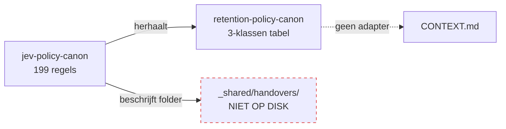
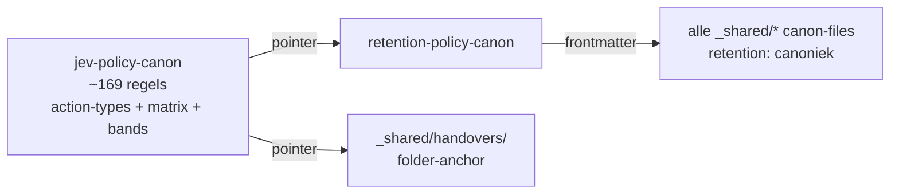

# Pass C — Architecture Review djinlabs umbrella (2026-09-24)

**Scope.** Umbrella `djinlabs_system_design/` als markdown-knowledge repo. **Method.** Matt Pocock `improve-codebase-architecture` vocabulary toegepast op canon-files (modules), ADRs (interfaces), cross-refs (seams) en CONTEXT.md-bestanden (adapters). Per-canon deletion test. Per-canon "één adapter = hypothetical seam; twee adapters = real seam".

**Refs gelezen.** `_shared/{icm,agent-discipline,jev-policy,retention-policy,state-formats,sync-discipline}-canon.md`; `_shared/AGENTS.md,hard-rules.md,naming-conventions.md`; `docs/adr/0001-state-formats-canon.md,docs/adr/0002-sync-discipline.md`; `decisions.md` (Ronde 1-13 lock); `docs/djinlabs-1-folder-fundamentelen-design.md`; `CONTEXT.md`; `audit-spoor/audit-2026-09-24-double-tree.md`; `research/r18-f0-design-doc-drift-inventarisatie.md`; 19 `CONTEXT.md`-adapters in `djinlabs/` + `webrnds/`.

## Executive summary

- 4 van 6 canon-files klaren de deletion test: `icm-canon`, `state-formats-canon`, `sync-discipline-canon` en `jev-policy-canon` hebben ≥2 echte adapters; verwijderen laat complexity naar N callers reizen.
- **`retention-policy-canon`** is een pass-through: één adapter (jev-policy-canon.md restate de 3 klassen + override verbatim), de beloofde `_shared/handovers/`-folder bestaat niet op disk, en de overige verwijzingen zijn research/ Gap K/L aspiraties zonder concrete adapter.
- **`jev-policy-canon`** vertoont Duplicated-Code + Mysterious-Name smell: ~30 regels (Retention-classes tabel, Handovers-sectie) zijn een herhaling van `retention-policy-canon` + een niet-bestaande folder. Cross-references zouden de canon ~30 regels korter maken en de drift tussen beide files onmogelijk.
- **Frontier drift**: `decisions.md` stopt formeel bij Ronde 13 (regel 253), terwijl disk Ronde 14-17 heeft (twee ADRs, drie design-docs, `jev-policy-canon V1.5`). Sync-discipline R16 zou dit moeten vangen maar de frontier-lijst zelf is niet geüpdatet.
- **`agent-discipline-canon`** heeft één adapter (umbrella `CONTEXT.md`-glossary) en wordt door geen van de Ronde 14-17 design-docs geciteerd. Hypothetical seam, geen real seam.
- Cross-cutting-without-anchor: Gap K (Jevons-clausule) + Gap L (selective compaction) uit `research/0xcodila-jev-engineering-roadmap-audit.md` + `research/jev-treg-blobbies-icm-integration-blueprint.md` zijn voorgestelde canonieke aanvullingen op `retention-policy-canon` zonder dat één canon die claimt.

## Vocabulary remap (code → markdown)

| Code-term | Markdown-equivalent in deze repo |
|---|---|
| module | canon-file (`_shared/*-canon.md`) of design-doc of ADR — elk met interface (cross-refs) + implementation (body) |
| interface | frontmatter YAML + cross-references in de header van een canon-file |
| implementation | body van de canon-file (de canonieke principes zelf) |
| depth | verhouding interface-grootte / body-grootte — diepe canon = weinig cross-refs, veel goed-ontwikkelde regels per concept |
| seam | waar de canon's interface leeft — bv. frontmatter of "Cross-references"-sectie |
| adapter | concrete consument van de canon aan een seam — `_internal/CONTEXT.md`-files, ADR-files, design-docs, research-audits |
| leverage | wat één canon oplevert over N adapters |
| locality | wat onderhouds-werk wint als de regel op één plek staat |
| deletion test | verwijder de canon in gedachten — als complexity verdwijnt: pass-through. Als complexity naar N callers reist: earning its keep. |
| hypothetical seam | één adapter; geen tweede. Matt Pocock: wacht op #2 voordat je het als echte seam behandelt. |

## Vijf deepening candidates

### A. `retention-policy-canon.md` is een pass-through — **Strong**

**Files.** `_shared/retention-policy-canon.md` (46 regels, abstracte 3-klassen-definitie + hiërarchie + override-mechanisme). Cross-refs: `_shared/jev-policy-canon.md` regel 144,199; `CONTEXT.md` regel 11; `research/*` 12x (Gap K, Gap L); `audit-spoor/audit-2026-09-24-double-tree.md` regel 26,111; `djinlabs/_internal/experimenten/rondasync/CONTEXT.md` regel 40,59.

**Problem — Speculative canon (Pass-through smell).** Verwijder `retention-policy-canon.md` in gedachten: `CONTEXT.md` glossary verliest één regel; `jev-policy-canon.md` verliest zijn duplicate tabel (regel 134-146) en een cross-ref; research-files verliezen Gap K/L die toch niet geadapt zijn. **Complexity vanishes, niet concentrates**. De beloofde `_shared/handovers/`-folder die de canon zou voeden bestaat niet op disk (find: 0 files). De enige echte consument is jev-policy-canon, en die consumeert door te kopiëren — geen echte seam.

**Solution — Drie opties, volgorde van voorkeur.** (1) **Promoveer de seam**: voeg `retention: canoniek` aan elke canon-file's frontmatter toe. Nu zijn er ineens ≥6 adapters (alle canon-files) in plaats van 1. (2) **Fork the canon**: splits retention-policy-canon in twee — een abstracte hierarchie (overleven) en een domein-specifieke toepassing (verhuizen naar jev-policy-canon §"Retention classes"). (3) **Schrappen en hernoemen**: houd alleen het jev-policy-canon §"Retention classes" over, plus een pointer-canoniek in `_shared/retention-policy-canon.md` van 8 regels.

**Benefits.** **Leverage**: ≥6 nieuwe adapters (canon-files), één canonieke plek voor retention, drift-detectie triviaal. **Locality**: één edit (frontmatter) dekt alle canon-files. **Deletion test** gaat van pass-through naar earning-keep.

**Before.**

```
retention-policy-canon ──(duplicate tabel)──► jev-policy-canon §Retention classes
                       ──(cross-ref only)────────► _shared/handovers/  [niet op disk]
                       ──(glossary mention)────►  CONTEXT.md
                       ──(Gap K/L aspiraties)──►  research/* (12 mentions, 0 adapters)
```

**After (optie 1 — promote seam).**

```
retention-policy-canon  ─► frontmatter `retention: canoniek` op alle _shared/*-canon.md
                        ─► back-reference: jev-policy-canon §Retention (single source)
                        ─► één matrix in canon: canon-file × retention-klasse × override
```

### B. `jev-policy-canon.md` is een Shallow canon (Duplicated Code / Middle Man) — **Strong**

**Files.** `_shared/jev-policy-canon.md` (199 regels). Probleem-gedeelten: regel 134-146 (Retention classes tabel) en regel 150-163 (Handovers vocabulary + naam-template). Beide zijn cross-references naar elders verpakt als herhaling.

**Problem — Duplicated Code + Mysterious Name.** Jev-policy-canon herhaalt retention-policy-canon's drie-klassen-tabel verbatim met alleen de *default-termijn-denrichting* als nieuw. Daarnaast beschrijft het `handovers` alsof `_shared/handovers/` een folder is, terwijl de folder niet bestaat (find levert 0 hits). De canon claimt dus vocab en naam-template voor een folder die door geen enkel ander bestand wordt gebruikt. **~30 regels body, 0 unieke regels**. Synchroon houden tussen twee canons = drift-risico (audit-spoor vond al partial-drift op retention-policy-canon in ronde 17).

**Solution.** Vervang regel 134-146 door: *"Retention classes volgens `_shared/retention-policy-canon.md`; de drie defaults (7j / permanent / 30d) zijn denkrichting, niet canonieke waarden."* Vervang regel 150-163 (Handovers) door: *"Naam-template `handover-YYYYMMDD-HHMM-<slug>.md` in `_shared/handovers/` — folder-anchor orthogonal aan agents."* Geen body-uitleg die elders leeft; alleen cross-refs. Bewaar de canon's unieke inhoud (action-types, fail-mode matrix, confidence bands, classify_jev, vraag-formulering, shadow/active modes, provider-as).

**Benefits.** Jev-policy-canon wordt ~30 regels korter en tight gefocused op wat *alleen* daar hoort (Jev-action vocabulary + fail-modes). Retention-policy-canon wordt de single source voor retention-regels. Drift tussen de twee files wordt structureel onmogelijk. Audit-tabel van 7×fail-mode-actions blijft diep.

**Before vs After (Mermaid).**





### C. Frontier drift — `decisions.md` stopt bij Ronde 13 — **Strong**

**Files.** `decisions.md` regel 253 ("the frontier is..." op items die allang closed zijn); frontier-lijst eindigt "Open frontier — Ronde 14 onwards". Disk-werkelijkheid: Ronde 14 (blobbies + jev-policy canon), Ronde 15 (state-formats-canon + ADR 0001), Ronde 16 (sync-discipline-canon + ADR 0002), Ronde 17 (jev-policy V1.5 + confidence bands + classify_jev).

**Problem — Frontier drift (cross-cutting without anchor).** Sync-discipline-canon R16 eist dat elke Ronde z'n frontier-items in `decisions.md` sluit. Ronde 14-17 zijn niet als zodanig gelocked in `decisions.md`, alleen in losse design-docs en ADRs. Generator-implementatie (Ronde 16 Q3=C) kan hierdoor niet starten: input-bron is incoherent. Audit-spoor/audit-2026-09-24-double-tree.md §1.2 identificeerde dit al (Drift A.0).

**Solution.** Eén Ronde-actie: voeg `## Cumulative log — Ronde 14-17` toe aan `decisions.md` onder de frontier-lijst. Per Ronde: datum, kern-beslissing, cross-ref naar design-doc + ADR. Niet de frontier-lijst zelf herschrijven — die double-touch met r18 f0 (drift-inhaal design-doc). Eén sectie, geen breaking change.

**Benefits.** Herstelt `decisions.md` als canonieke bron van frontier-status (één bron van waarheid per canoniek-principe — past bij Ronde 15's *Markdown = knowledge*). Maakt Ronde 19+ generator-implementatie mogelijk. Sluit direct aan op audit A.1 aanbeveling — vijf-voudige stacked update uit die audit komt hiermee in één edit.

**Before vs After.**

```
Before:                                  After:
decisions.md                              decisions.md
├── Ronde 1-13 cumulatief log ✓           ├── Ronde 1-13 cumulatief log ✓
├── Frontier-lijst (regel 253)            ├── Frontier-lijst (regel 253) [ongewijzigd]
│   zegt: "open frontier R14+"            └── Cumulative log — Ronde 14-17 (nieuw)
└── (geen R14-17)                            ├── R14: blobbies + jev-policy canon + retention-policy canon
                                              ├── R15: state-formats-canon (ADR 0001)
adr/0001, adr/0002 staan los              ├── R16: sync-discipline (ADR 0002)
docs/r15-, docs/r16- design los           └── R17: jev-policy V1.5, confidence bands, classify_jev
audit-spoor/ronde-17-sync zegt "?"        adr/0001, adr/0002 hebben nu cross-ref
                                          audit-spoor sluit aan op cumulative log
```

### D. `agent-discipline-canon.md` heeft één adapter (hypothetical seam) — **Worth exploring**

**Files.** `_shared/agent-discipline-canon.md` (21 regels, drie basisregels: splits samengestelde verzoeken, vraag bij UI-verzoeken op externe skills, documenteer flow-positie van elke bridge). Aangeroepen door: `CONTEXT.md` umbrella glossary; `_shared/AGENTS.md` noemt `hard-rules`+`naming-conventions`+`icm-canon` maar niet agent-discipline-canon; **geen** Ronde 14-17 design-doc refereert ernaar (audit Drift A.2).

**Problem — Speculative canon (lowercase).** Per Matt Pocock: *one adapter = hypothetical seam*. Eén umbrella-glossary-vermelding is geen tweede adapter. De drie regels zijn goed geformuleerd, maar `docs/r15-f1-state-formats-design.md` en `docs/r16-f9-sync-discipline-design.md` noemen agent-discipline-canon niet — terwijl ze zouden moeten checken of hun eigen locked answers agent-discipline-conform zijn (bv. splitsen van samengestelde verzoeken tijdens de grill). Geen tweede adapter = geen bewijs dat de canon daadwerkelijk wordt geraadpleegd.

**Solution — Twee opties.** (a) **Promoveer**: voeg in elke Ronde 14-17 design-doc één regel "Agent-discipline: deze Ronde splitste verzoek X in sub-Q's per `_shared/agent-discipline-canon.md` regel 1" — maakt de drie regels een echte canon-checklist. (b) **Verhuis**: de drie regels zijn vrij klein en orthogonaal aan canon (gaan over hoe de agent werkt, niet over kennis); overweeg samentrekking met `_shared/AGENTS.md` als "Gebruik-discipline"-sectie. Dat verlaagt interface-load zonder kennis te verliezen.

**Benefits.** (a) Maakt de canon testbaar — elke Ronde kan auditen of agent-discipline is gevolgd. (b) Verlaagt canon-file-count van 6 naar 5 (één bron van waarheid voor agent-gedrag). Beide opties maken de deletion test robuuster.

**Before vs After.**

```
Before:                                    After (optie a):
agent-discipline-canon                       agent-discipline-canon
└── (één adapter)                               ├── adapter 1: CONTEXT.md glossary
    └── CONTEXT.md (umbrella)                   ├── adapter 2-5: design-docs R14-17
                                                └── citation-regel in elke Ronde
```

### E. Cross-cutting without anchor — Gap K & Gap L wachten op een canon — **Worth exploring**

**Files.** `research/0xcodila-jev-engineering-roadmap-audit.md` regel 235-294 (Gap K "Jevons-clausule" + Gap L "selective compaction"); `research/jev-treg-blobbies-icm-integration-blueprint.md` regel 397 (retention-mapping voor Jev/Treg); `research/matt-typesafe-coding-agent-audit.md` regel 421 + `research/everestchris6-jev-native-agency-architecture.md` regel 578 (zelfde gaten). Voorgestelde plek: `_shared/retention-policy-canon.md` nieuwe §§.

**Problem — Cross-cutting without anchor.** Vier research-files claimen dat retention-policy-canon twee nieuwe canonieke principes nodig heeft (Jevons-clausule: oudere runs verdwijnen zodra nieuwe zijn geverifieerd; selective compaction: welke runtime-state wordt gecomprimeerd op welke termijn). Maar geen canon-file claimt die concepten. Resultaat: elke nieuwe integratie (Jev+Treg, COS-router, blobbies) herontdekt het gat. `r18-f0-design-doc-drift-inventarisatie.md` noemt dit niet expliciet, maar `audit-2026-09-24-double-tree.md` §1.2 (Drift A.0) dekt het wel impliciet (Ronde 18+).

**Solution.** Ronde 18-item: maak `_shared/retention-policy-canon.md` §"Compaction" (Gap L) en §"Jevons-clausule" (Gap K) canoniek. Eén Ronde, sync-discipline-conform. Combineer met Candidate A (promoveer de seam): als elke canon-file `retention: canoniek` krijgt in frontmatter, krijgt compaction-principe ineens een echte anker.

**Benefits.** Vier research-gap-aspiraties krijgen één canoniek anker. Eén edit haalt complexity weg uit research-fase ("gap staat al in canon, dus geen gap meer") en maakt retention-policy-canon dieper — van 46 regels naar ~70, met echte cross-cutting leverage.

**Before vs After.**

```
Before (research-gap islands):           After (anchored in retention-policy-canon):
                                                  
0xcodila ──╮                                     0xcodila ──╮
jev-treg  ──┤                                   jev-treg  ──┤
matt-typesafe╯ (4 losse Gap K/L verwijzingen)   matt-typesafe╯   ──► retention-policy-canon
                                                  ─► §Jevons-clausule
                                                  ─► §Compaction (selective)
                                                  ─► §Retention-mapping voor Jev/Treg
```

## Top recommendation

**Candidate A (retention-policy canon pass-through)** eerst. Drie redenen:

1. **Hoogste leverage per edit**: één frontmatter-veld op zes canon-files maakt zes adapters waar nu één is. Dat is de minimale actie die de canon van pass-through naar earning-keep brengt.
2. **Ontkoppelt Candidate B**: zodra retention-policy-canon een echte canon is met echte adapters, kan jev-policy-canon §Retention classes gereduceerd worden tot cross-ref zonder dat de retention-regels verweesd raken — twee vliegen in één Ronde.
3. **Maakt Candidate E implementeerbaar**: Gap K/L krijgen een canon-anker dat al echte adapters heeft. De vier research-aspiraties convergeren op één plek.

**Concrete volgorde.** (1) Ronde 18-item A.1 (audit-actie): voeg `retention: canoniek` toe aan alle zes `_shared/*-canon.md` frontmatter (kleine edit, sync-discipline-conform). (2) Ronde 18 zelfde Ronde: pas Candidate B toe — vervang regel 134-146 en 150-163 in jev-policy-canon door cross-references. (3) Volgende Ronde: Candidate C (cumulative log) en Candidate E (Jevons + Compaction) — beide in één Ronde.

## Appendix — Deletion test per canon-file

| Canon-file | Bij deletion… | Verdict |
|---|---|---|
| `icm-canon.md` | **Concentrates**: walk-test, factory/product-split, één-job-per-folder worden herhaald in `djinlabs/_internal/experimenten/{,cos/,rondasync/}/CONTEXT.md`, `docs/djinlabs-1-folder-fundamentelen-design.md` regel 99, `decisions.md` regel 167. 89 grep-matches in de boom. | Earning its keep |
| `agent-discipline-canon.md` | **Mostly vanishes**: drie regels staan nergens anders. Eén glossary-vermelding in `CONTEXT.md`. Geen Ronde 14-17 design-doc refereert ernaar (audit Drift A.2). | Pass-through / hypothetical seam |
| `jev-policy-canon.md` | **Concentrates**: action-types vocabulary, fail-mode matrix (7×sites), confidence bands, classify_jev, shadow/active modes, provider-as overview zijn unieke kennis. Tientallen cross-refs in design-docs, research/, CONTEXT.md. Wel 30 regels duplicate (zie Candidate B). | Earning its keep (na Candidate B: earning-more) |
| `retention-policy-canon.md` | **Vanishes**: enige echte adapter is jev-policy-canon.md die de 3 klassen herhaalt. `_shared/handovers/`-folder bestaat niet. Research-gap-aspiraties (Gap K, L) zonder concrete adapter. | **Pass-through** (sterkste vondst) |
| `state-formats-canon.md` | **Concentrates**: matrix canonieke-bron ↔ runtime-state-spiegel is uniek. ADR 0001, sync-discipline-canon regel 107-110, djinlabs/AGENTS.md regel 27 citeren 'm. Echte seam. | Earning its keep |
| `sync-discipline-canon.md` | **Concentrates**: drie orthogonale assen (wie/wanneer/hoe) + drift-detectie trigger zijn unieke kennis. ADR 0002, design-docs r16, meerdere CONTEXT.md's citeren 'm. Drie Rondes actief gebruikt. | Earning its keep |

---

Geschreven 2026-09-24. Method: Matt Pocock `improve-codebase-architecture` + canon-eigen deletion test. Niet bewezen: dat de voorgestelde Candidate A-edit in één Ronde past zonder verdere drift — Ronde 18a/b test nodig.
